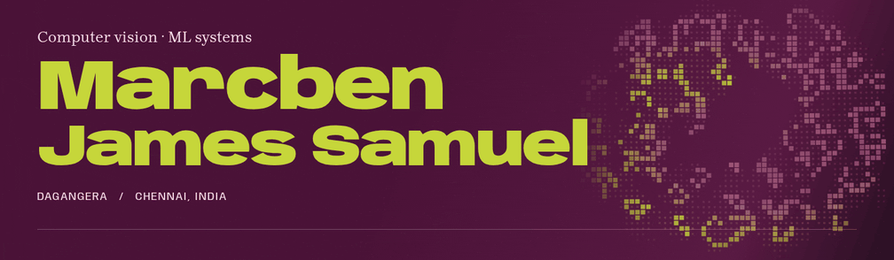
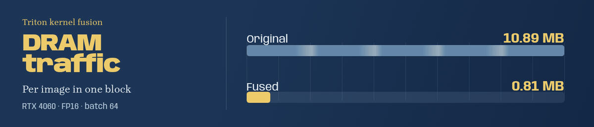

<picture>
  <source media="(prefers-reduced-motion: reduce)" srcset="./assets/profile-cover.png">
  
</picture>

I'm an AI & Data Science undergraduate in Chennai. I work on few-shot visual inspection and measure what these models cost to run.

[Portfolio source](https://github.com/DaganGera/portfolio) · [LinkedIn](https://www.linkedin.com/in/marcben-james-samuel-117405385)

## Selected research

### [Triton kernel fusion for local vision models](https://github.com/DaganGera/nca)

Fused a neural cellular automaton update in Triton. The hybrid vision model went from **1,589 to 2,201 images/s** on an RTX 4060 at the same measured CIFAR-100 accuracy. Inside the fused block, DRAM traffic per image fell from **10.89 MB to 0.81 MB**.

<picture>
  <source media="(prefers-reduced-motion: reduce)" srcset="./assets/triton-traffic.png">
  
</picture>

[Roofline plot](https://github.com/DaganGera/nca/blob/main/results/fig1_roofline.png) · [Benchmark results](https://github.com/DaganGera/nca#results)

### [PRGA · Few-shot visual inspection](https://github.com/DaganGera/onion_research)

Co-developed a **1.1M-parameter** graph adapter that connects image regions to written class descriptions. I audited near-duplicates in onion photos and rebuilt the evaluation to hold out entire scenes. The two-backbone variant reached **0.890 macro-F1** at four photos per class in the equal-training comparison.

### [SPOT-TAP · Defect classification from boxes](https://github.com/DaganGera/SPOT-TAP)

Joint first author on a study of box-supervised few-shot classification. A **9K-parameter patch head** learns defect types on frozen CLIP and DINOv2 features. Evaluated on four held-out benchmarks. Manuscript under review.

### [Emergent Attention · Local rules in a Vision Transformer](https://github.com/DaganGera/Emergent-Attention)

Replaced the first six attention blocks of a Vision Transformer with a neural cellular automaton. The hybrid reached **81.91% top-1 on CIFAR-100** with **6.46M parameters**.

## Other projects

- [**The tokenizer tax**](https://github.com/DaganGera/tokenizer-tax) — Measured GPU decoding energy across Indian languages. On the NVIDIA T4 benchmark, Odia used **3.9×** the per-sentence energy of English with Qwen3.5-4B.
- [**MediKiosk**](https://github.com/DaganGera/Patient-Case-Taking) — Built an offline clinical-history kiosk for **22 Indian languages**, with speech, translation, OCR, and a local language model.
- [**SysHealth+**](https://github.com/DaganGera/Sys-Health) — Built a drive-health monitor around SMART telemetry and a failure classifier trained on Backblaze data.
